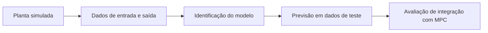

# Visão geral

**Título do trabalho:** Identificação de Sistemas e Controle Preditivo Baseado em Modelos de Espaço de Estados Estruturados (SSMs).

**Integrantes registrados no relatório 1:** Gustavo Jae Min Yu, Ian Seo Takose e Vinicius Kenji Yamada. **Orientador registrado:** Felipe Miguel Pait.

## Pergunta geral

Podemos aprender, a partir das entradas e saídas de um sistema, um modelo baseado em SSMs neurais capaz de prever sua evolução e auxiliar um controlador preditivo?

O trabalho tem duas etapas diferentes:

1. **Identificação e previsão:** aprender e avaliar o modelo.
2. **Controle:** usar esse modelo para escolher entradas futuras, respeitando restrições.

## Recorte proposto para outubro

Avaliar uma rede pequena com Mamba-3 em um massa–mola–amortecedor, comparando-a com uma referência ARX. O protocolo distingue um passo e vários passos. A comparação com Mamba-2 será adicionada se houver tempo e ambiente viável.

Esse recorte é uma proposta de trabalho e deve ser discutido com o grupo e o orientador. Não há registro de aprovação específica deles nesta pasta.

## O que já foi feito

O relatório 1 registra estudo introdutório de S4, Mamba, HiPPO e complexidade. Em 12/10, foi executada a base clássica do experimento linear. Veja [[Estado atual]] e [[E001 - Referencias lineares]].

## O que queremos aprender

- A rede aprende a relação entre força aplicada e posição futura?
- O erro permanece aceitável quando o modelo realimenta suas próprias previsões?
- Em que condições ARX ou o modelo neural têm melhor desempenho?
- O custo de avaliação permite estudar integração com MPC?

Não precisamos provar que Mamba-3 é superior em todo cenário. Uma comparação delimitada, reproduzível e bem interpretada pode contribuir para o TCC.

## Fonte inicial

[[Relatorio 1.pdf]] — relatório entregue em 14/09/2026, copiado para o vault sem alterar seu conteúdo.

Veja também [[Cronograma]], [[Protocolo comum]] e [[Leituras]].

