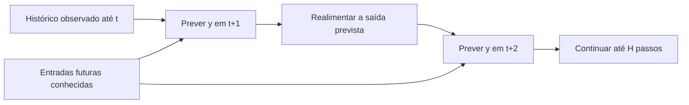

# Previsão e simulação

Há dois regimes diferentes de avaliação. Confundi-los pode fazer um modelo parecer mais útil para controle do que o experimento realmente mostrou.

## Um passo com medições reais

O modelo recebe $u_t$, $y_t$ e o passado disponível, e prevê $y_{t+1}$. Na origem seguinte, volta a receber uma medição real. Essa avaliação mede o desempenho quando o histórico observado está disponível a cada instante.

## Vários passos sem medições futuras

Na origem $t$, conhecemos o passado e uma sequência futura de entradas. Depois da primeira previsão, o modelo usa suas próprias saídas previstas:

$$
\hat y_{t+1}\longrightarrow [u_{t+1},\hat y_{t+1}]\longrightarrow\hat y_{t+2}\longrightarrow\cdots
$$

Não podemos inserir $y_{t+1}$ real para calcular a previsão seguinte dentro do mesmo horizonte. Essa medição pertence ao futuro da origem.

## O exemplo disponível

![[E001-simulacao-50-passos.png]]

Persistência mantém a posição inicial constante durante o horizonte. ARX acompanha a saída real neste cenário linear ideal. O gráfico é um trecho predefinido; a tabela do experimento usa todas as origens de teste.

## Erro final e erro da trajetória

- **RMSE final:** erro apenas no passo $H$.
- **RMSE da trajetória:** reúne todos os passos de 1 até $H$.
- **Curva por horizonte:** mostra como o erro muda ao longo da previsão.

Em nosso experimento, $T_s=0,05$ s. Os horizontes 1, 10 e 50 correspondem a 0,05 s, 0,5 s e 2,5 s. Consulte [[Protocolo comum]].

Bom resultado nesse protocolo ainda não constitui prova de estabilidade ou desempenho em MPC.

